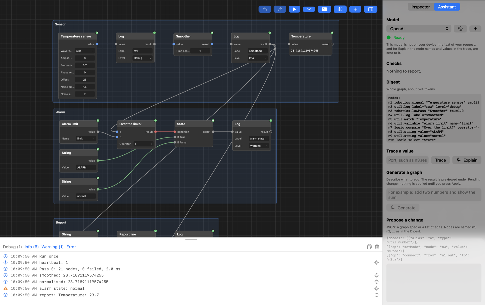
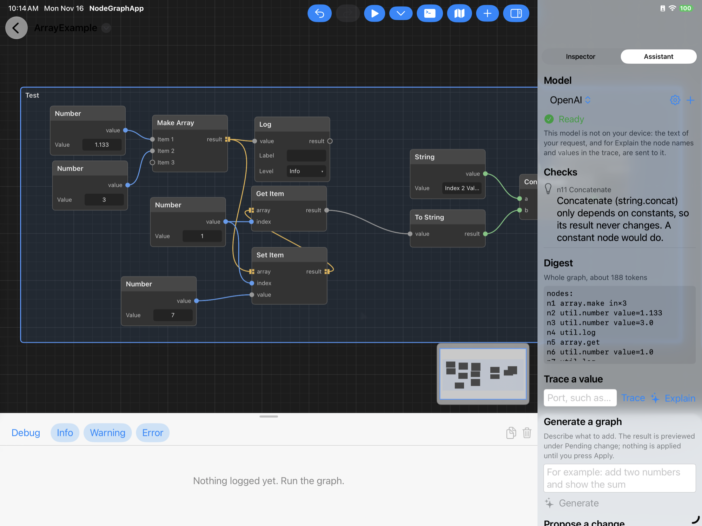

# NodeGraph

A general-purpose node graph system in Swift, intended for many domains (robotics scenarios, video editing, and more). The editor runs on macOS and iPadOS; the core, the built-in nodes, graph storage and the headless runner also run on Linux. litegraph.js is used as a feature reference only.





**Status:** pre-1.0. The core, the built-in nodes, the SwiftUI editor, local graph storage, the robotics and video packs, a headless runner and the graph assistant all exist and are tested. The server is not started. See `docs/PLAN.md`.

## Layout

```
Package.swift       One SwiftPM package; every module below is a library product
Packages/
  NodeGraphCore/    Pure Swift core: models, graph, execution, serialization (no UI)
  NodeGraphNodes/   Built-in node packs (math, logic, string, flow, data, utility)
  NodeGraphUI/      SwiftUI Canvas editor
  NodeGraphSync/    Graph storage and sync (server later)
  NodeGraphRobotics/ Node pack for robotics scenario generation
  NodeGraphVideo/   Node pack for video editing
  NodeGraphAssistant/ Model-independent assistant logic (graph digest, lints, tools)
  NodeGraphAI/      Model providers (Claude, OpenAI-compatible, on-device) for the assistant
  NodeGraphCLI/     NodeGraphRunKit library and the ng-run headless runner
  NodeGraphTutorials/ DocC tutorials and their tested step code (no product)
examples/           Example graphs and TemperaturePack, a finished node pack
App/                The macOS and iPadOS app
docs/               ARCHITECTURE.md, DECISIONS.md, PLAN.md, FEATURE_AUDIT.md, ASSISTANT.md, TUTORIALS.md
scripts/ci.sh       Build and test everything (--ios adds simulator builds)
NodeGraph.xcworkspace
```

To use it in your own app or package, see "Use it in your own app" below.

Copyright 2026 Bruce Wade. Licensed under Apache-2.0 (see `LICENSE`).

## Platforms

Swift 6.3 or later. The editor and the Apple-only modules need macOS 26 or iOS 26; the rest runs anywhere Swift does, including Linux (tested on Ubuntu 24.04 with Swift 6.4.2 and in CI).

| Module | macOS and iOS | Linux |
| --- | --- | --- |
| `NodeGraphCore`, `NodeGraphNodes`, `NodeGraphSync` | Yes | Yes |
| `NodeGraphRobotics`, `NodeGraphVideo` | Yes | Yes |
| `NodeGraphAssistant` (logic, no model calls) | Yes | Yes |
| `NodeGraphRunKit` and the `ng-run` runner | Yes | Yes |
| `NodeGraphUI` (SwiftUI editor) | Yes | No |
| `NodeGraphAI` (model providers, uses FoundationModels and the Keychain) | Yes | No |

## Use it in your own app

The repository is one Swift package that vends every module as a library product, so you take only the ones you need. The package is named `NodeGraph`; use that name in every `package:` argument.

**In an Xcode app project.** A new SwiftUI app has no `Package.swift`; add the package from Xcode instead:

1. Choose File > Add Package Dependencies and enter `https://github.com/detectedstealth/NodeGraph`. For a local checkout, choose Add Local and pick the `NodeGraph` folder.
2. Pick a dependency rule. The latest release is `0.1.0`. While the package is pre-1.0, minor versions may break things, so choose Up to Next Minor from `0.1.0` (or Branch: `main` to follow development).
3. Tick the products your app target needs (table below). For an editor, that is `NodeGraphCore`, `NodeGraphNodes` and `NodeGraphUI`.
4. Set the app's deployment target to macOS 26 and iOS 26 or later, and build with a Swift 6.3 or newer toolchain.

**In your own package** (a node pack, or a library that holds your app's code):

```swift
// swift-tools-version: 6.3
import PackageDescription

let package = Package(
    name: "MyDomain",
    platforms: [.macOS(.v26), .iOS(.v26)],
    products: [.library(name: "MyDomain", targets: ["MyDomain"])],
    dependencies: [
        // Pre-1.0, a minor version can break things, so stay within one minor version:
        .package(url: "https://github.com/detectedstealth/NodeGraph", .upToNextMinor(from: "0.1.0")),
        // To follow development: .package(url: "https://github.com/detectedstealth/NodeGraph", branch: "main"),
        // A local checkout (its folder must be named NodeGraph):
        // .package(path: "../NodeGraph"),
    ],
    targets: [
        .target(
            name: "MyDomain",
            dependencies: [
                .product(name: "NodeGraphCore", package: "NodeGraph"),
                .product(name: "NodeGraphNodes", package: "NodeGraph"),
                .product(name: "NodeGraphUI", package: "NodeGraph"),
            ]
        ),
        .testTarget(name: "MyDomainTests", dependencies: ["MyDomain"]),
    ]
)
```

A node pack that has no UI needs only `NodeGraphCore`; `examples/TemperaturePack` is a finished one. Do not add `swift-collections`, `swift-log` or `swift-argument-parser` yourself unless your code uses them directly; they come in with the package.

| You want | Products |
| --- | --- |
| A node pack with no UI | `NodeGraphCore` |
| The standard nodes (math, logic, string, flow, data, utility) | add `NodeGraphNodes` |
| The editor (canvas, inspector, palette) | add `NodeGraphUI` (Apple platforms only) |
| Saving, loading and stores | add `NodeGraphSync` |
| Robotics or video nodes | `NodeGraphRobotics`, `NodeGraphVideo` |
| Assistant logic, no model calls | `NodeGraphAssistant` |
| Model providers and generation | `NodeGraphAI` (Apple platforms only) |
| Run a document headless | `NodeGraphRunKit` |

The demo app in `App/NodeGraphApp` shows the wiring: `GraphApp.swift` sets up the document group and `ContentView.swift` builds the model and the canvas.

## Built with AI

This project is developed using an AI-assisted engineering workflow using Claude Code, working inside Xcode. Human-directed architecture, planning, and review govern all changes. Development practices are fully documented: CLAUDE.md defines assistant operating rules, docs/DECISIONS.md records architectural decisions and tradeoffs, docs/PLAN.md tracks implementation phases, and all Core changes require accompanying tests. AI-generated proposals are reviewed before acceptance, both during framework development and within the graph assistant itself.

## Learn

DocC tutorials teach the packages from an empty graph to your own node pack: building, running, saving and showing a graph, writing a node pack, the robotics and video packs, and headless runs. Preview them locally:

```bash
./scripts/docs.sh preview          # opens the tutorials
./scripts/docs.sh site             # static site for GitHub Pages in .docs-site/
```

Plan and status: `docs/TUTORIALS.md`. A finished example pack is in `examples/TemperaturePack`.

## Build and test

```bash
./scripts/ci.sh          # tests everything on macOS, builds the docs
./scripts/ci.sh --ios    # also builds each module for the iOS simulator
```

On Linux, `swift build` and `swift test` build and test the modules that run there. A few tests measure time; on a slow or busy machine, run `NODEGRAPH_TIMING_SCALE=4 swift test --no-parallel` to loosen their limits.

Open `NodeGraph.xcworkspace` in Xcode. Roadmap: `docs/PLAN.md`. Design: `docs/ARCHITECTURE.md`. Contributor and agent rules: `CLAUDE.md`.
